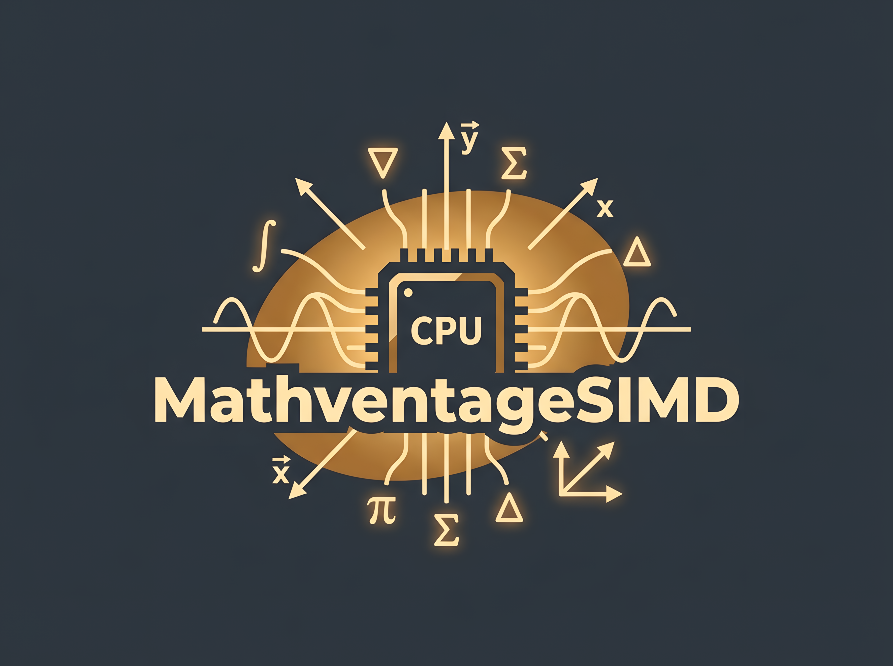
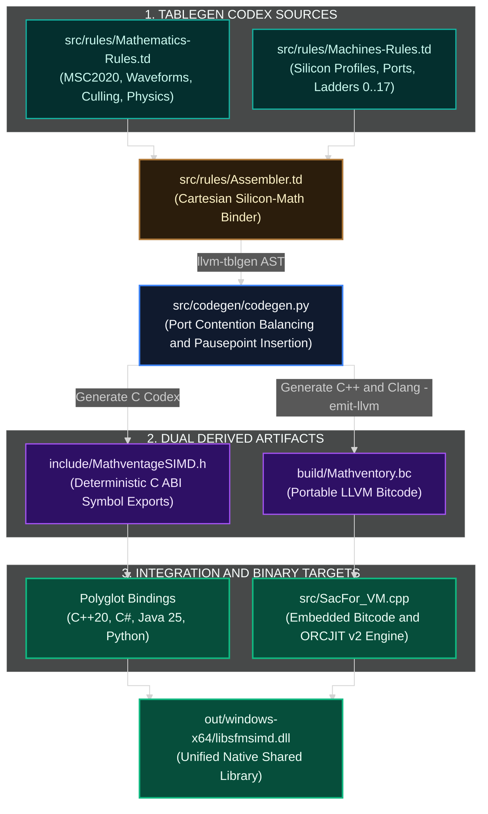
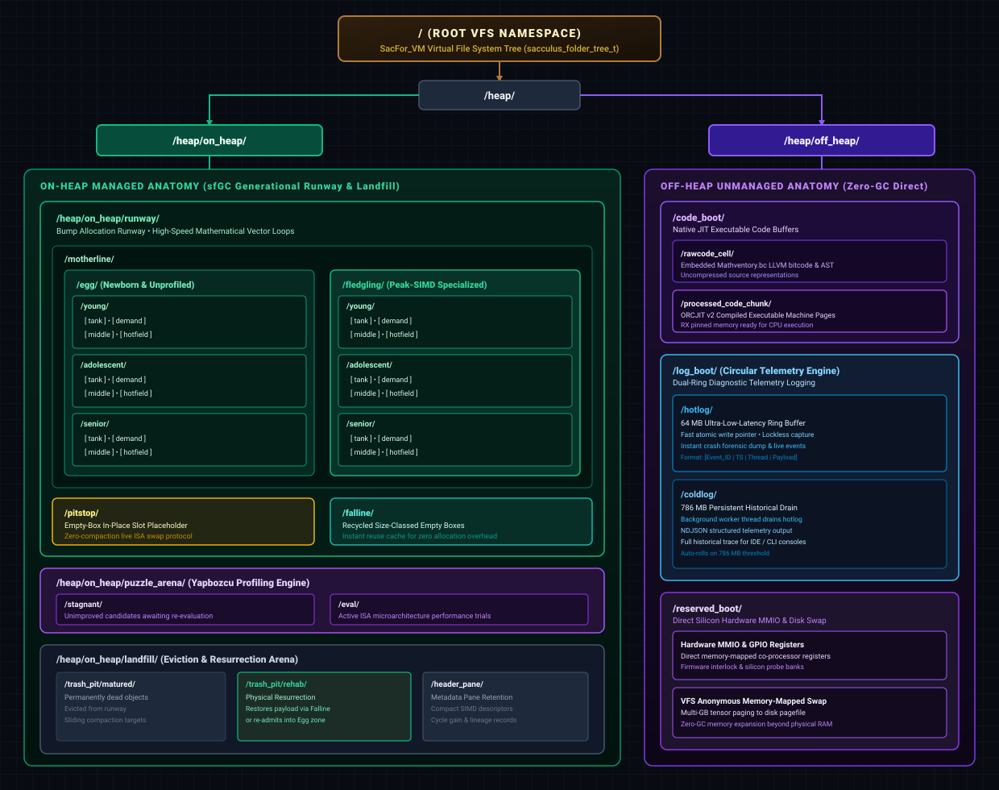

<p align="center">
  
</p>

<h1 align="center">MathventageSIMD & SacculusForge</h1>

<p align="center">
  <strong>High-performance, pure-CPU analytical compute engine covering MSC2020 mathematics, open-world visibility culling, and discrete quantum physics.</strong><br>
  <em>Engineered with LLVM TableGen silicon synthesis, hardware port contention modeling, autonomous SFVM/sfGC runtime, and multi-limb emulation.</em>
</p>

<p align="center">
  
  
  
  
  
</p>

---

## Executive Summary

MathventageSIMD is an industrial-grade, sovereign compute engine designed to achieve maximum instructions-per-cycle (IPC) on modern host processors without GPU dependencies, PCIe bus serialization penalties, or proprietary driver stacks.

By unifying declarative LLVM TableGen hardware definitions with a formal mathematical codex encompassing over 1,250 MSC2020 analytical functions, 512 generative waveforms, discrete Planck-scale quantum mechanics, and real-time geometric culling, MathventageSIMD turns commodity and server CPUs into high-throughput tensor computing engines. It bridges raw silicon vector units (AVX10.2, AVX-512, APX, AMX, ARM SVE2, RISC-V Vector) with a zero-compaction, autonomous virtual machine runtime (**SacculusForge SFVM / sfGC**) providing live instruction-set re-steering, self-healing memory integrity, and zero-copy polyglot language docking.

---

## Why MathventageSIMD?

Modern computing pipelines are frequently burdened by driver complexity, GPU memory fragmentation, PCIe transfer latency, and unpredictable compiler vectorization heuristics. MathventageSIMD solves these fundamental challenges through a radically grounded architectural approach:

### 1. Pure-CPU Sovereignty (Zero GPU Driver Overhead)
Accelerated compute should not require gigabytes of proprietary graphics drivers, fragile CUDA/ROCm environment configurations, or PCIe bandwidth bottlenecks. MathventageSIMD treats the host CPU as a first-class compute accelerator. From 4-core embedded chips to 128-core workstation beasts, it harnesses native execution ports, vector registers, and multi-channel L3 cache architectures to deliver deterministic, low-latency throughput right where your application data already resides.

### 2. TableGen Silicon Grounding & Port Contention Modeling
Standard compilers rely on generic autovectorization passes that often fail to balance CPU execution pipelines. In MathventageSIMD, every single kernel is derived via LLVM TableGen from verified physical microarchitecture profiles (`Machines-Rules.td`). The engine models execution port saturations (e.g. Intel Ports 0, 1, 5, AMD Zen 4/5 dual 512-bit FP pipes, ARM SVE2 units), balances arithmetic intensity, unrolls loops to avoid register pressure exhaustion, and guarantees deterministic instruction selection across 18 dispatch ladder levels (Levels 0 through 17).

### 3. Autonomous SFVM Runtime & Empty-Box Pitstop Protocol
Generic garbage collectors and runtime engines induce stop-the-world pauses, cache pollution, and heap fragmentation. The SacculusForge Virtual Machine (**SFVM**) introduces a dedicated **Flight Traffic Controller** architecture:
- **Motherline (Egg & Fledgling)**: Organizes tasks into unprofiled newborn objects and peak-optimized execution slots.
- **In-Place Pitstop Protocol**: When the runtime puzzle optimizer (*Yapbozcu*) detects that a running object can be promoted to a wider SIMD ISA (such as upgrading AVX2 to AVX-512 or AVX10.2), the object is temporarily routed through the Pitstop. An **Empty-Box placeholder** is left in its memory slot, the new ISA kernel is linked in-place, and execution resumes immediately with zero heap compaction and zero application stalls.
- **Falline Instant Recycling**: Decommissioned slots are tracked in size-classed recycling chains for instant $O(1)$ re-allocation.

### 4. Continuous & Multi-Limb Numeric Precision (F8–F256 & I/U8–U256)
When numerical algorithms demand precision beyond native 64-bit hardware, MathventageSIMD provides automatic multi-limb software emulation:
- Supports mini-floats (F8, F16), standard floats (F32, F64), and extended multi-limb representations (`2x32b`, `2x64b` double-double, and `4x64b` / `8x32b` quad-double arithmetic providing up to 212 mantissa bits).
- Full symmetric signed and unsigned integer matrices (I8 through I256, U8 through U256).
- Deterministic fixed-point fractional partitioning (`Q16.16`, `Q32.32`, `Q64.64`, `Q128.128`) for real-time physics and embedded systems requiring zero rounding drift.

### 5. Unified Computational Breadth
Rather than being restricted to dense linear algebra, MathventageSIMD provides comprehensive domain coverage:
- **MSC2020 Mathematics**: Complete computable spectrum of special functions, hypergeometric series, elliptic integrals, Bessel variants, and orthogonal polynomials.
- **Discrete Planck-Scale Quantum Physics**: Solves Heisenberg uncertainty and field operators in discrete space, preventing continuum singularities and zero or infinity divisions.
- **Astrophysics & Relativistic Geodesics**: Simulates null geodesics and photon trajectories in Kerr black hole curved spacetime.
- **High-Performance Geometry Culling**: 6-plane frustum tests, distance LOD with hysteresis, and voxel face bitmask elimination for large-scale rendering.

### 6. Zero-Copy Polyglot Interoperability
MathventageSIMD delivers a clean, unified C ABI with zero-overhead wrappers across modern language ecosystems:
- **C++20**: Suffix-free overloaded template methods with scoped cache pre-warming.
- **C# / F#**: High-speed pinned `Span<T>` and `ReadOnlySpan<T>` interop.
- **Java 25**: Official support for both modern Foreign Function & Memory (FFM `jextract`) and high-throughput JNI.
- **Python**: Zero-copy NumPy buffer protocol integration for seamless scientific pipelines.
- **LLVM ORCJIT v2**: Pre-compiled bitcode (`Mathventory.bc`) embedded directly within the shared library for runtime JIT compilation and specialized kernel fusion.

---

## Architecture Overview

MathventageSIMD executes pure CPU computing directly on silicon vector execution ports without GPU offloading penalties. The system is split into two complementary engines:

1. **MathventageSIMD (MSIMD)**: The mathematical kernel codex and silicon ISA synthesizer generated via LLVM TableGen.
2. **SacculusForge VM (SFVM / sfGC)**: The autonomous runtime providing generational GC, empty-box ISA re-steering, cacheline volatility control, and multi-tier memory scheduling.



---

## 1. MSIMD Core Engine

### TableGen-Driven Synthesis
- **Declarative Hardware Rules (`Machines-Rules.td`)**: Models hardware execution ports (e.g. Ports 0, 1, 5 on Intel Core, dual 512-bit FP units on AMD Zen 4/5, NEON/SVE2 pipelines on ARM, and RVV units on RISC-V). Defines dispatch ladder levels `0..17` from scalar fallbacks to `AVX10.2 Converged 512-bit`.
- **Mathematical Codex (`Mathematics-Rules.td`)**: Formal definition of 512 analytical waveform generators, PDE stencils, relativistic geodesics, discrete quantum operators, and geometry culling routines.
- **Port Contention Balancing (`codegen.py`)**: Automatically schedules vector intrinsics to minimize execution port stalls and inserts amortized GC pausepoints (`if ((i & 511u) == 0u) sf_gc_pausepoint_poll();`).

### Numeric Precision Matrix & Multi-Limb Emulation
Provides an orthogonal $3 \times 6 = 18$ type matrix across floating-point, signed, and unsigned integers:
- **Types**: `F8, F16, F32, F64, F128, F256` | `I8, I16, I32, I64, I128, I256` | `U8, U16, U32, U64, U128, U256`.
- **Multi-Limb Silicon Emulation**: When native silicon lacks 128-bit or 256-bit ALUs, operations automatically map to multi-limb representations: `2x16b`, `4x16b`, `2x32b`, `4x32b`, `2x64b` (double-double arithmetic), and `4x64b` / `8x32b` (quad-double arithmetic providing up to 212 mantissa bits).

### Specialized Domain Kernels
- **Open-World Visibility Culling**: 6-plane frustum test against axis-aligned bounding boxes (`msimd_cull_frustum_aabbs`), signed distance bounding sphere culling (`msimd_cull_frustum_spheres`), distance LOD with hysteresis margin (`msimd_cull_distance_lod`), and 6-neighbor binary voxel bitmask culling (`msimd_cull_voxel_hidden_faces`) with reference GLSL compute shader models.
- **Discrete Planck-Scale Quantum Physics**: Bounded Heisenberg uncertainty simulations without continuum infinity divergence.
- **Relativistic Astrophysics**: Raymarching null geodesics in Kerr black hole curved spacetime.
- **Acoustic Raytracing**: 3D FDTD wave stepping with pressure field propagation on CPU vector registers.

---

## 2. SacculusForge VM (SFVM) & sfGC Runtime

### SacFor_VM Virtual File System (VFS) Anatomy

Internally, `SacFor_VM.cpp` structures every execution arena, generational runway, telemetry stream, and unmanaged memory buffer as a deterministic, Unix-like hierarchical path tree (`sacculus_folder_tree_t`). This design eliminates global locks and enables fine-grained folder eviction, live telemetry filtering, and strict memory compartmentalization:

<p align="center">
  
</p>

#### On-Heap Managed VFS Hierarchy (`/heap/on_heap/`)
- **/runway/motherline/**: Contains `/egg/` (newborn unprofiled tasks) and `/fledgling/` (Yapbozcu peak-SIMD optimized kernels). Each zone spans `/young/`, `/adolescent/`, and `/senior/` generations partitioned across `[ tank ]`, `[ demand ]`, `[ middle ]`, and `[ hotfield ]` rooms.
- **/runway/pitstop/**: Houses live empty-box slots for zero-compaction ISA re-steering.
- **/runway/falline/**: Holds size-classed recycled empty-box chunks for instant reuse.
- **/puzzle_arena/**: The Yapbozcu profiling playground (`/stagnant/` for re-evaluation queues and `/eval/` for live micro-benchmarks).
- **/landfill/**: Disposed objects (`/trash_pit/matured/` for dead items, `/trash_pit/rehab/` for physical payload resurrection back into the runway, and `/header_pane/` for compacted metadata retention).

#### Off-Heap Unmanaged VFS Hierarchy (`/heap/off_heap/`)
- **/code_boot/**: Stores source bitcode in `/rawcode_cell/` and native ORCJIT v2 executable RX machine code pages in `/processed_code_chunk/`.
- **/log_boot/**: Dual-ring circular telemetry engine featuring a 64 MB atomic `/hotlog/` ring buffer and a 786 MB background `/coldlog/` persistent drain file.
- **/reserved_boot/**: Dedicated to direct co-processor hardware MMIO registers and anonymous disk pagefile swap for multi-GB tensors exceeding physical RAM.

---

### Inside `SacFor_VM.cpp`: The Autonomous Silicon Engine

To an end user or application developer, `SacFor_VM.cpp` might look like a massive runtime, but its purpose is straightforward: **it acts as an ultra-high-speed "Flight Traffic Controller" for your CPU.**

Unlike the JVM or Python runtime, **SFVM is NOT an interpreter.** It does not execute bytecode slowly in software. Instead, it manages memory, vector lanes, and hardware threads so that pure SIMD mathematical operations execute at the absolute physical speed of your silicon with zero cache thrashing and zero memory pauses.

#### 1. Why On-Heap vs. Off-Heap Matters to You
- **On-Heap (The Mathematical Runway):**  
  Every mathematical operation or tensor task submitted to SFVM lives on the **Runway**. Allocations here do not call the operating system's slow `malloc()`. Instead, they "bump-allocate" sequentially at memory bus speed. The `sfGC` garbage collector monitors this area in the background, recycling completed tasks with zero stop-the-world stutter.
- **Off-Heap (The Giant Tensor Arena):**  
  When dealing with massive datasets (e.g. 50 GB voxel worlds, machine learning weights, or physics fields), storing them inside standard garbage-collected memory would cause periodic application freezes. SFVM keeps raw tensor payloads **Off-Heap** or memory-mapped to disk via its internal VFS swap. Your multi-gigabyte tensors will **never trigger a GC pause**, and can be shared zero-copy directly with Java, C#, or Python.

#### 2. The Pitstop: Seamless In-Place Optimization
When you run a loop of calculations, the background optimizer (**Yapbozcu**) continuously monitors CPU performance. If it finds that your chip supports a faster instruction set (such as upgrading a kernel from AVX2 to AVX-512):
1. The running object is temporarily moved to the **Pitstop**.
2. An **Empty-Box** placeholder is left in its memory slot so the rest of the application never notices a gap.
3. The new SIMD intrinsic is written into the slot, and execution resumes immediately.  
*Result:* **Zero memory compaction overhead, zero stalls, and automatic runtime speedups.**

#### 3. Execution Topology & Thread Intelligence
- **4-Point Safety Gates:** `Safepoint` (autonomous GC poll), `Hookpoint` (performance audit), `Controlpoint` (synchronized GC with Java/C# runtimes), and `Pausepoint` (clean execution halt) ensure threads never deadlock or corrupt state.
- **Hardware-Aware Scheduling:** Whether running on an 8-core laptop (`SCP`), a 128-core AMD EPYC server (`MCP`), or a hybrid Intel Core i9 / Xeon Max with asymmetric Performance and Efficiency cores (`HybridDual`), SFVM pins heavy math to the fastest cores and offloads background housekeeping to efficiency cores.

#### 4. The Self-Healing Shield & VFS Panic
Mathematical stencils and complex simulations can occasionally encounter invalid numbers (NaN/Inf) or damaged memory graphs:
- **Autonomous Repair:** `sacculus_self_heal_engine_t` automatically breaks dangling pointer cycles, resets diverged stencils, and reports exact diagnostics (`SFVM captured 'D' corruption at graph in heap!`).
- **Fail-Fast VFS Panic:** If a required internal memory path or VFS branch is missing, SFVM engages a platform-independent diagnostic alert and performs a clean fail-fast exit, guaranteeing that corrupted data is never silently written to disk.

---

## 3. API Guide & Polyglot Usage

### C ABI Foundation (`MathventageSIMD.h` & `SacculusForge.h`)
All DLL exports use deterministic C ABI symbols with explicit precision suffixes (`_f32`, `_f64`, `_u32`):

```c
#include <SacculusForge.h>
#include <MathventageSIMD.h>

SF_custominiVm_init();

float planes[24] = { /* 6 frustum planes */ };
float mins[300], maxs[300];
uint8_t visible[100];

msimd_cull_frustum_aabbs_f32(planes, mins, maxs, 100, visible);

SF_custominiVm_shutdown();
```

### Modern C++20 (`SacculusForge.hpp` & `MathventageSIMD.hpp`)
Provides suffix-free, template-overloaded methods under the `SF` and `MSIMD` namespaces:

```cpp
#include <SacculusForge.hpp>
#include <MathventageSIMD.hpp>

SF_custominiVm_init();

// Suffix-free overload: compiler selects float or double automatically
SF::Cull::FrustumAABBs(planes, mins.data(), maxs.data(), count, visible.data());

// Scoped priority compute with L1/L2 cache pre-warming
{
    SF::BatchScope scope(8 /* Priority 0-10 */, true /* Bypass Warmup */);
    SF::Wave::BesselJ0(in_data, out_data, count);
}

SF_custominiVm_shutdown();
```

### Java 25 (FFM `jextract` & JNI)
Both modern Foreign Function & Memory (FFM) and high-speed native JNI bindings are provided:

```java
import com.sacculusforge.msimd.MathventageSIMD;
import com.sacculusforge.vm.SacculusForgeVM;

SacculusForgeVM.init();

// Suffix-free overloaded Java API
MathventageSIMD.cullFrustumAABBs(frustumPlanes, aabbMins, aabbMaxs, count, visibility);

SacculusForgeVM.shutdown();
```

### C# / F# (`Span<T>` & P/Invoke)
Zero-copy execution using managed memory pinning:

```csharp
using SacculusForge;

Span<float> mins = stackalloc float[3 * 64];
Span<float> maxs = stackalloc float[3 * 64];
Span<byte> visibility = stackalloc byte[64];
ReadOnlySpan<float> frustum = stackalloc float[24];

MSIMD.CullFrustumAABBs(frustum, mins, maxs, 64, visibility);
```

### Python (NumPy Buffer Interop)
Zero-copy ndarray array evaluation:

```python
import numpy as np
import mathventagesimd as msimd

visibility = msimd.cull_frustum_aabbs(frustum_planes, aabb_mins, aabb_maxs)
```

---

## 4. Build Instructions

### Toolchain Prerequisites
- **Compiler**: Clang-CL / LLVM $\ge 22.1.5$ (MSVC `cl.exe` is strictly forbidden).
- **Build System**: CMake $\ge 3.25$ and Ninja.
- **Dependencies**: Intel oneTBB (threading) and Intel OpenVINO.
- **Python**: Python 3.12 (used by the TableGen codegen synthesizer).

### Build Commands

```bash
# Configure with Ninja and Clang-CL
cmake -B build -G Ninja \
  -DCMAKE_CXX_COMPILER="clang-cl" \
  -DCMAKE_C_COMPILER="clang-cl" \
  -DCMAKE_BUILD_TYPE=Release

# Compile runtime DLL and verification test
cmake --build build --target mathvantage sf_verification_test

# Outputs:
#   out/windows-x64/libsfmsimd.dll
#   out/windows-x64/sf_verification_test.exe
```

---

## 5. License

This project is dual-licensed under:
- **Apache License, Version 2.0** ([LICENSE-APACHE](LICENSE-APACHE) or [http://www.apache.org/licenses/LICENSE-2.0](http://www.apache.org/licenses/LICENSE-2.0))
- **MIT License** ([LICENSE-MIT](LICENSE-MIT) or [http://opensource.org/licenses/MIT](http://opensource.org/licenses/MIT))

You may select either license at your option.
